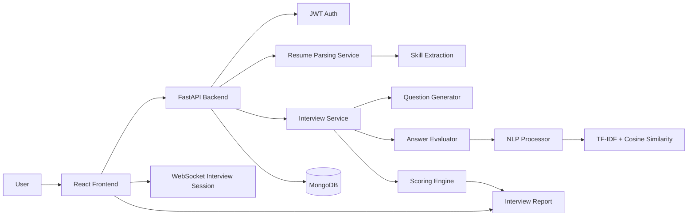
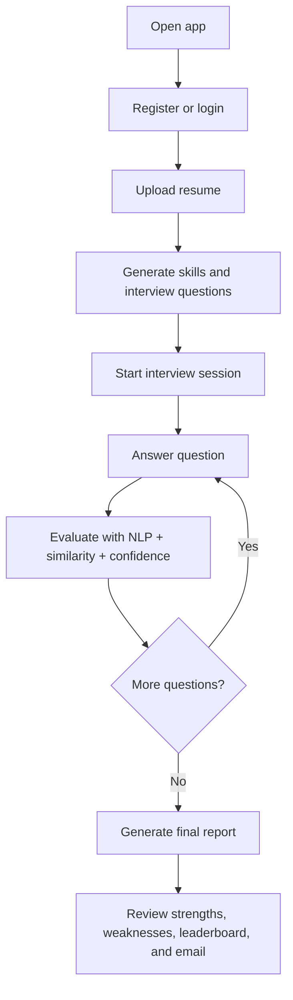

# AI Interview Bot

<div align="center">
  
  
  
  
  
</div>

<p align="center">
  <strong>Custom AI interview preparation platform for technical interviews, resume-based Q&A, and confidence-aware evaluation.</strong>
</p>

<p align="center">
  <a href="https://github.com/Roodransh1983/Ai_interview_bot">Repository</a> ·
  <a href="#project-overview">Overview</a> ·
  <a href="#system-architecture">Architecture</a> ·
  <a href="#installation-and-setup">Setup</a> ·
  <a href="#api-documentation">API</a>
</p>

## Table of Contents

- [Project Overview](#project-overview)
- [Problem Statement](#problem-statement)
- [Key Features](#key-features)
- [Technology Stack](#technology-stack)
- [System Architecture](#system-architecture)
- [How the Custom AI Engine Works](#how-the-custom-ai-engine-works)
- [Interview Workflow](#interview-workflow)
- [Screenshots and Demo Gallery](#screenshots-and-demo-gallery)
- [Project Directory Structure](#project-directory-structure)
- [API Documentation](#api-documentation)
- [Prerequisites](#prerequisites)
- [Installation and Setup](#installation-and-setup)
- [Backend Configuration](#backend-configuration)
- [Frontend Configuration](#frontend-configuration)
- [Environment Variables](#environment-variables)
- [Running the Project](#running-the-project)
- [Docker Setup](#docker-setup)
- [Deployment Guide](#deployment-guide)
- [Security Considerations](#security-considerations)
- [Future Improvements](#future-improvements)
- [Learning Outcomes](#learning-outcomes)
- [Author Information](#author-information)
- [License and Contributions](#license-and-contributions)

---

## Project Overview

AI Interview Bot is a full-stack interview practice platform designed to simulate realistic technical interviews using a resume-driven, custom AI engine. The application lets a candidate upload a resume, extracts relevant technical skills, generates domain-specific questions, evaluates answers using NLP and similarity-based scoring, and produces a final interview report.

The product is intentionally built without external AI APIs. Instead, it uses a local rule-based and NLP-driven pipeline based on:

- PDF/DOCX resume parsing
- keyword extraction
- TF-IDF and cosine similarity
- question generation from a predefined skill bank
- confidence detection from answer wording
- report generation with strengths, weaknesses, and suggestions

This project is suitable for candidates preparing for interviews, educators evaluating student responses, and developers building end-to-end interview simulation systems.

## Problem Statement

Modern interview preparation tools often require external AI services, are expensive to operate, or are not tailored to each candidate's actual skill profile. Many candidates also prepare with generic questions instead of questions aligned with their resume and expertise.

AI Interview Bot addresses this by combining:

- resume-based skill extraction
- personalized question generation
- answer scoring through NLP and similarity metrics
- interview mode support for text and video scenarios
- actionable feedback and performance reports

## Key Features

### Implemented features

- Resume upload and parsing for PDF and DOCX files
- Resume skill extraction and profile-aware question generation
- Custom AI evaluation engine without external AI APIs
- TF-IDF + cosine similarity answer matching
- NLTK and spaCy-style NLP processing pipeline for keyword extraction and preprocessing
- Rule-based interview question generation based on resume keywords
- Text interview mode
- Video interview mode with browser camera access and MediaPipe face detection
- Looking-away and attention warnings during video interviews
- Interview scoring and report generation
- Radar-chart-like category summaries and strengths/weaknesses analysis
- SMTP-based report email delivery
- Interview leaderboard based on average score
- React + Tailwind + Framer Motion frontend
- FastAPI backend with MongoDB persistence
- JWT-based authentication with bcrypt password hashing

### Future / planned areas

- More advanced multilingual support
- Deeper behavioral analysis for video interviews
- Better evaluation models beyond rule-based heuristics
- Interview analytics dashboard with historical trends
- Expanded question banks for more domains and roles

---

## Technology Stack

| Component | Technology | Purpose |
| --- | --- | --- |
| Frontend | React, Vite, Tailwind CSS, Framer Motion | Web UI for landing page, dashboard, interviews, and reports |
| Backend | FastAPI | REST API and WebSocket-based interview orchestration |
| Programming Language | Python | Core application logic, AI engine, services, and data flow |
| Database | MongoDB with Motor | Persistence for users, interviews, reports, and leaderboard data |
| Authentication | JWT + Passlib + Bcrypt | Secure user registration, login, and authorization |
| Resume Parsing | PyPDF2, python-docx | Extract text from uploaded PDF and DOCX resumes |
| NLP / ML | NLTK, spaCy, scikit-learn | Tokenization, keyword extraction, TF-IDF, and cosine similarity |
| Real-Time Video | WebRTC browser APIs + MediaPipe Face Mesh | Video interview monitoring and face tracking |
| Email | SMTP (Gmail compatible config) | Sending interview reports by email |
| Dev / Infra | Docker, Docker Compose | Local containerized setup for MongoDB, backend, and frontend |

---

## System Architecture



The architecture follows a simple pattern: user interaction in the frontend, authenticated API and WebSocket requests in the backend, resume-based personalization, local NLP evaluation, and report persistence in MongoDB.

## How the Custom AI Engine Works

The engine is built around a rule-based and NLP-assisted approach rather than an external LLM or cloud AI model.

1. Resume parsing extracts text from PDF/DOCX files.
2. Relevant skills are matched against a predefined skill dictionary and NLP-based keyword extraction.
3. The question generator maps those skills to categories such as Python, JavaScript, React, SQL, Machine Learning, and HR.
4. The interview engine chooses a question set based on user profile and difficulty.
5. For each answer, the evaluator uses:
   - keyword matching against ideal keywords
   - TF-IDF vectorization and cosine similarity against the ideal answer
   - answer length adequacy scoring
   - confidence detection based on hesitation and uncertainty phrases
6. The scoring engine combines results into a final score, strengths/weaknesses, and suggestions.

### Resume skill extraction

The resume service reads the uploaded file, extracts the text, and looks for known technology keywords such as Python, React, SQL, Docker, AWS, machine learning, and communication. It also runs NLP keyword extraction on the raw text to find important domain-specific terms.

### Question selection

The `QuestionGenerator` maps extracted skills to question categories. This means a resume emphasizing React or JavaScript will produce more frontend and JavaScript-oriented questions, while a machine learning resume will trigger ML-centric interview prompts.

### TF-IDF and cosine similarity

The `NLPProcessor` uses `TfidfVectorizer` and `cosine_similarity` to compare the candidate answer against the ideal answer. This provides a semantic signal beyond basic keyword matching and helps capture whether the answer is conceptually close to the expected response.

### Keyword matching and answer length

The `AnswerEvaluator` combines three scoring signals:

- keyword match percentage (40%)
- semantic similarity score (40%)
- answer length adequacy (20%)

This approach rewards substantial, relevant responses while penalizing overly short or extremely verbose answers.

### Confidence detection

The `ConfidenceDetector` estimates confidence by checking for hesitation words, uncertainty phrases, and confidence boosters. This is a lightweight heuristic approach rather than a trained classifier.

### Video monitoring with MediaPipe and WebRTC

The frontend interview mode uses browser camera access and the MediaPipe Face Mesh library to detect face landmarks and track whether the candidate is facing the camera. The application can raise warnings when the user looks away, which is then used as additional video behavior context during the interview flow.

---

## Interview Workflow



## Screenshots and Demo Gallery

No screenshots or demo assets are currently committed in this repository.

The sections below are placeholders for future screenshots and product visuals.

### Placeholder gallery

- Home / landing page: Coming soon
- Login / registration page: Coming soon
- Resume upload flow: Coming soon
- Main interview interface: Coming soon
- Final report page: Coming soon
- Leaderboard view: Coming soon

> Note: This repository does not currently include a verified public deployment or screenshot assets.

---

## Project Directory Structure

```text
AI_interview_bot/
├── README.md
├── docker-compose.yml
├── backend/
│   ├── Dockerfile
│   ├── requirements.txt
│   ├── run.py
│   └── app/
│       ├── __init__.py
│       ├── config.py
│       ├── database.py
│       ├── main.py
│       ├── models/
│       │   ├── interview.py
│       │   └── user.py
│       ├── routes/
│       │   ├── auth.py
│       │   ├── interview.py
│       │   ├── leaderboard.py
│       │   ├── report.py
│       │   └── resume.py
│       ├── services/
│       │   ├── auth_service.py
│       │   ├── email_service.py
│       │   ├── interview_service.py
│       │   └── resume_service.py
│       └── utils/
│           └── security.py
│
├── backend/ai_engine/
│   ├── __init__.py
│   ├── answer_evaluator.py
│   ├── confidence_detector.py
│   ├── nlp_processor.py
│   ├── question_bank.py
│   ├── question_generator.py
│   └── scoring_engine.py
│
└── frontend/
    ├── Dockerfile
    ├── package.json
    ├── vite.config.js
    ├── tailwind.config.js
    ├── postcss.config.js
    ├── index.html
    ├── public/
    └── src/
        ├── App.jsx
        ├── index.css
        ├── main.jsx
        ├── components/
        │   └── layout/
        │       └── Navbar.jsx
        ├── pages/
        │   ├── Dashboard.jsx
        │   ├── InterviewMode.jsx
        │   ├── Landing.jsx
        │   ├── Leaderboard.jsx
        │   ├── Login.jsx
        │   ├── Register.jsx
        │   ├── Report.jsx
        │   └── ResumeUpload.jsx
        ├── services/
        │   └── api.js
        └── store/
            ├── authStore.js
            ├── interviewStore.js
            └── themeStore.js
```

## API Documentation

The backend exposes a FastAPI API with authentication, resume, interview, report, and leaderboard routes.

| Method | Endpoint | Purpose | Notes |
| --- | --- | --- | --- |
| GET | `/` | API health / root response | Basic app info |
| GET | `/health` | Health check | Verifies backend is live |
| POST | `/auth/register` | Register a user | Returns JWT token |
| POST | `/auth/login` | Login a user | Returns JWT token |
| GET | `/auth/me` | Fetch current user | Protected route |
| POST | `/resume/upload` | Upload PDF/DOCX resume | Protected route |
| GET | `/resume/` | Fetch parsed resume | Protected route |
| POST | `/interview/start` | Start a new interview | Protected route |
| POST | `/interview/answer` | Submit an answer | Protected route |
| POST | `/interview/complete/{session_id}` | Complete interview session | Protected route |
| GET | `/interview/session/{session_id}` | Fetch session | Protected route |
| WS | `/interview/ws` | Real-time WebSocket interview | Handles session flow |
| GET | `/report/{report_id}` | Fetch a report | Protected route |
| GET | `/report/history/me` | Fetch user reports | Protected route |
| POST | `/report/{report_id}/email` | Send report via email | Protected route |
| GET | `/leaderboard/` | Retrieve leaderboard | Public-ish route |
| GET | `/leaderboard/me` | Get current user's rank | Protected route |

### Example request

```bash
curl -X POST http://localhost:8000/auth/register \
  -H "Content-Type: application/json" \
  -d '{
    "name": "Jane Doe",
    "email": "jane@example.com",
    "password": "secret123"
  }'
```

---

## Prerequisites

Before running the project locally, ensure you have:

- Python 3.11+
- Node.js 18+
- npm or yarn
- MongoDB running locally or via Docker Compose
- Git

For Windows, macOS, or Linux, the project setup is the same; commands differ mainly in shell usage.

---

## Installation and Setup

### 1) Clone the repository

```bash
git clone https://github.com/Roodransh1983/Ai_interview_bot.git
cd Ai_interview_bot
```

### 2) Backend setup

```bash
cd backend
python -m venv venv
```

Activate the virtual environment:

#### Windows (PowerShell)

```powershell
.\venv\Scripts\Activate.ps1
```

#### Windows (Command Prompt)

```cmd
venv\Scripts\activate.bat
```

#### macOS / Linux

```bash
source venv/bin/activate
```

Install dependencies:

```bash
pip install -r requirements.txt
```

### 3) Frontend setup

```bash
cd ../frontend
npm install
```

### 4) Start MongoDB

You can either run MongoDB locally or use Docker Compose:

```bash
docker compose up -d mongodb
```

---

## Backend Configuration

The backend configuration is defined in `backend/app/config.py` and reads environment variables using `pydantic-settings`.

Key default values:

- `MONGODB_URI = mongodb://localhost:27017`
- `DATABASE_NAME = ai_interview_bot`
- `SECRET_KEY = your-super-secret-key-change-in-production`
- `ALGORITHM = HS256`
- `ACCESS_TOKEN_EXPIRE_MINUTES = 1440`
- `SMTP_HOST = smtp.gmail.com`
- `SMTP_PORT = 587`
- `UPLOAD_DIR = uploads`
- `MAX_FILE_SIZE = 10MB`
- `QUESTIONS_PER_INTERVIEW = 5`
- `QUESTION_TIME_SECONDS = 120`

The backend entry point is:

```bash
cd backend
uvicorn app.main:app --host 0.0.0.0 --port 8000 --reload
```

---

## Frontend Configuration

The frontend uses Vite and reads the API base URL from:

```bash
VITE_API_URL
```

The default value is:

```bash
http://localhost:8000
```

Run the frontend with:

```bash
cd frontend
npm run dev
```

Then open:

```text
http://localhost:5173
```

---

## Environment Variables

The repository does not include a committed `.env.example` file, but the app expects environment variables similar to the defaults defined in `backend/app/config.py` and `docker-compose.yml`.

At minimum, configure:

```env
MONGODB_URI=mongodb://localhost:27017
DATABASE_NAME=ai_interview_bot
SECRET_KEY=your-super-secret-key-change-in-production
SMTP_HOST=smtp.gmail.com
SMTP_PORT=587
SMTP_USER=
SMTP_PASSWORD=
```

Important:

- Do not commit real credentials to source control.
- Use local environment variables or your deployment platform's secret store.
- SMTP credentials are only required if you want email report delivery.

---

## Running the Project

### Local backend

```bash
cd backend
source venv/bin/activate  # or .\venv\Scripts\Activate.ps1 on Windows
uvicorn app.main:app --host 0.0.0.0 --port 8000 --reload
```

### Local frontend

```bash
cd frontend
npm install
npm run dev
```

### Local database

```bash
docker compose up -d mongodb
```

The app will typically run as:

- Backend: `http://localhost:8000`
- Frontend: `http://localhost:5173`

---

## Docker Setup

This repository includes a Docker Compose setup for the full stack.

```bash
docker compose up --build
```

This starts:

- MongoDB on port `27017`
- Backend on port `8000`
- Frontend on port `5173`

The project also includes individual Dockerfiles in both `backend/` and `frontend/`.

---

## Deployment Guide

This repository does not include a verified production deployment configuration or a live public deployment URL.

For local or private deployment, the intended flow is:

1. Set environment variables for the backend and frontend.
2. Run MongoDB in a managed environment or container.
3. Deploy the FastAPI backend to a host or cloud service.
4. Deploy the React frontend using a static hosting service or Node server.
5. Set the frontend `VITE_API_URL` to the deployed backend URL.
6. Configure SMTP credentials if email delivery is required.

> No deployment URL is verified in this repository at the time of writing.

---

## Security Considerations

- JWT tokens are used for authentication.
- Passwords are stored using bcrypt via `passlib` and `bcrypt`.
- The app includes CORS configuration for local frontend origins.
- `SECRET_KEY` should be changed before production use.
- Do not expose `SMTP_USER` and `SMTP_PASSWORD` in public repos.
- Uploaded resume files are stored temporarily and removed after parsing.
- MongoDB should be protected behind a controlled network or secured credentials in production.

---

## Future Improvements

- Expand resume parsing to support more file formats and edge cases
- Add more question categories for backend, DevOps, cloud, and system design
- Improve answer scoring using richer NLP features and candidate history
- Add authentication and user-role management beyond the current login flow
- Introduce a richer dashboard for interview trends and analytics
- Support more interview styles such as voice, live coding, or asynchronous interviews
- Improve video monitoring with better attention and fraud detection heuristics

---

## Learning Outcomes

This project demonstrates a broad set of full-stack and AI engineering skills, including:

- Python backend development with FastAPI
- Web application architecture and API design
- React frontend development with modern UI patterns
- MongoDB integration and data modeling
- JWT authentication and secure password hashing
- Resume parsing and document processing
- Natural language processing and keyword extraction
- TF-IDF and cosine similarity-based evaluation
- Rules-based AI design without external model APIs
- Real-time interview workflows and WebSocket communication
- User feedback systems and report generation

---

## Author Information

- Author: `Roodransh1983`
- Repository: https://github.com/Roodransh1983/Ai_interview_bot

This project is intended as a serious software engineering portfolio project for internship, project showcase, and technical evaluation contexts.

## License and Contributions

### License

This repository does not currently include a license file. No license has been explicitly specified in the project at the time of writing.

### Contributions

Contributions are welcome if you want to:

- improve resume parsing quality
- expand the question bank
- improve evaluation logic
- fix frontend UX issues
- add tests and documentation

To contribute:

1. Fork the repository.
2. Create a feature branch.
3. Make your changes.
4. Submit a pull request with a clear description.

---

## Summary

AI Interview Bot is a custom interview preparation and evaluation platform built using Python, FastAPI, React, and MongoDB. It focuses on applicant-specific evaluation, custom AI-driven scoring, and a practical interview preparation workflow without depending on external AI services.

It is designed to be understandable, extensible, and suitable for a B.Tech CSE portfolio, academic project review, and recruiter-facing technical documentation.

---

<p align="center">
  <i>Built for interview preparation, technical evaluation, and practical AI/NLP experimentation.</i>
</p>
