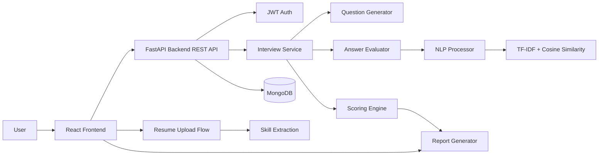
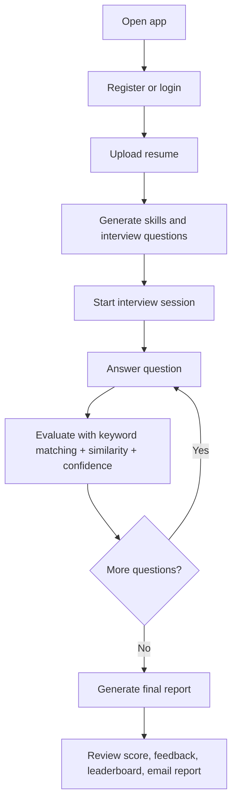

# AI Interview Bot

<div align="center">
  
  
  
  
  
</div>

<p align="center">
  <strong>Resume-driven AI interview practice platform for technical interview preparation.</strong>
</p>

<p align="center">
  <a href="https://github.com/Roodransh1983/Ai_interview_bot">Repository</a> ·
  <a href="#project-overview">Overview</a> ·
  <a href="#system-architecture">Architecture</a> ·
  <a href="#installation-and-setup">Setup</a> ·
  <a href="#api-documentation">API</a>
</p>

## Table of Contents

- [Project Overview](#project-overview)
- [Problem Statement](#problem-statement)
- [Key Features](#key-features)
- [Technology Stack](#technology-stack)
- [System Architecture](#system-architecture)
- [How the Custom AI Engine Works](#how-the-custom-ai-engine-works)
- [Interview Workflow](#interview-workflow)
- [Screenshots and Demo Gallery](#screenshots-and-demo-gallery)
- [Project Directory Structure](#project-directory-structure)
- [API Documentation](#api-documentation)
- [Prerequisites](#prerequisites)
- [Installation and Setup](#installation-and-setup)
- [Backend Configuration](#backend-configuration)
- [Frontend Configuration](#frontend-configuration)
- [Environment Variables](#environment-variables)
- [Running the Project](#running-the-project)
- [Docker Setup](#docker-setup)
- [Deployment Guide](#deployment-guide)
- [Security Considerations](#security-considerations)
- [Future Improvements](#future-improvements)
- [Learning Outcomes](#learning-outcomes)
- [Author Information](#author-information)
- [License and Contributions](#license-and-contributions)

---

## Project Overview

AI Interview Bot is a full-stack interview preparation platform that uses a candidate's resume as the basis for personalized technical interview questions. It parses uploaded resumes, extracts relevant skills, generates domain-specific questions, evaluates answers, and produces a final performance report.

The system is designed to work without external AI APIs. It uses local rule-based logic and a custom evaluation pipeline built around:

- PDF and DOCX resume parsing
- keyword extraction
- TF-IDF and cosine similarity
- rule-based question generation
- answer scoring and confidence estimation
- final report generation with strengths, weaknesses, and suggestions

This project is intended for students, developers, and recruiters who want an interview simulator that is more relevant to the user's actual background and experience.

## Problem Statement

Many interview preparation tools rely on generic questions, require external services, or do not adapt to the candidate's experience. AI Interview Bot addresses that gap by tailoring interview questions to the skills found in the uploaded resume and scoring answers with a transparent, local evaluation workflow.

## Key Features

### Implemented features

- Resume upload and parsing for PDF and DOCX files
- Skill extraction from resume content
- Resume-tailored question generation
- Custom AI evaluation engine without external AI APIs
- TF-IDF + cosine similarity answer matching
- NLTK-based keyword extraction and preprocessing
- scikit-learn similarity scoring
- Rule-based question generation based on resume keywords
- Text interview mode
- Video interview mode using browser camera access and MediaPipe Face Mesh
- Local looking-away warning in video mode
- Interview scoring and report generation
- Strengths/weakness analysis
- SMTP-based report email delivery
- Leaderboard based on average score
- React + Tailwind + Framer Motion frontend
- FastAPI backend with MongoDB persistence
- JWT authentication with bcrypt password hashing

### Not currently implemented as part of the active project flow

- Voice-level confidence analysis
- Video-based confidence scoring added to the final report
- Backend analysis of gaze data or camera behavior beyond local UI warnings
- External AI model integration

---

## Technology Stack

| Component | Technology | Purpose |
| --- | --- | --- |
| Frontend | React, Vite, Tailwind CSS, Framer Motion | UI for landing page, dashboard, interview flow, reports, and leaderboard |
| Backend | FastAPI | API layer and application logic |
| Programming Language | Python | Core backend logic, NLP, evaluation, and business services |
| Database | MongoDB with Motor | Persistence for users, sessions, reports, and leaderboard data |
| Authentication | JWT + Passlib + Bcrypt | Secure user registration, login, and protected routes |
| Resume Parsing | PyPDF2, python-docx | Extraction of candidate resume text |
| NLP / ML | NLTK + scikit-learn | Tokenization, keyword extraction, TF-IDF, cosine similarity |
| Video Monitoring | browser `getUserMedia` + MediaPipe Face Mesh | Local face landmark tracking and looking-away warnings |
| Email | SMTP (Gmail-compatible config) | Sending interview reports by email |
| Containerization | Docker / Docker Compose | Local development setup |

Note: The source code currently uses NLTK and scikit-learn for NLP evaluation. There is no verified spaCy integration in the repository's active code path.

---

## System Architecture



The backend does expose a WebSocket endpoint at `/interview/ws`, but the current frontend interview flow in this repository uses Axios REST calls (`/interview/start`, `/interview/answer`, `/interview/complete/{session_id}`) rather than WebSockets for interview orchestration.

## How the Custom AI Engine Works

The evaluation engine is rule-based and NLP-driven rather than dependent on external LLMs or cloud AI APIs.

1. A resume is uploaded and its text is extracted.
2. Relevant technical keywords are identified from the candidate's background.
3. These skills are mapped to question categories.
4. Questions are generated from a built-in question bank.
5. Each answer is evaluated using keyword matching, semantic similarity, answer length, and confidence heuristics.
6. The report aggregates the results and produces strengths, weaknesses, and improvement suggestions.

### Resume skill extraction

The `ResumeService` reads uploaded PDF/DOCX files, extracts text, and looks for known technical keywords such as Python, JavaScript, React, SQL, Docker, AWS, and machine learning. It also runs an NLP keyword extraction pass to identify important terms beyond the static skill list.

### Question selection

The `QuestionGenerator` maps extracted skills to related categories and draws questions from the internal question bank. This means that a resume rich in Python or ML topics will generate more relevant questions in those domains.

### TF-IDF and cosine similarity

`NLPProcessor` uses `TfidfVectorizer` and `cosine_similarity` to compare the user answer against the ideal answer. This gives a semantic similarity score between the candidate's answer and the expected concept coverage.

### Keyword matching and answer length

Per-question scoring is implemented as:

- 40% keyword matching
- 40% TF-IDF cosine similarity
- 20% answer-length adequacy

The score is computed in `AnswerEvaluator.evaluate()` using the weighted formula:

```text
total_score = keyword_score * 0.4 + similarity_score * 0.4 + length_score * 0.2
```

This rewards answers that include the right concepts, are semantically close to the ideal response, and are of sufficient length without being overly verbose.

### Confidence detection

Confidence is estimated using phrase-level heuristics in `ConfidenceDetector`. It looks for hesitation terms, uncertainty patterns, and confidence booster words. This is a text-based heuristic, not a model-based voice or video analysis system.

### Video monitoring with MediaPipe and browser camera APIs

In video mode, the frontend requests camera access using browser `MediaDevices.getUserMedia()` and analyzes the live feed with MediaPipe Face Mesh. It raises a local looking-away warning when the face landmarks indicate the candidate is not facing the camera. This warning is displayed in the UI only and is not sent to the backend or included in the interview score or final report.

---

## Interview Workflow



## Screenshots and Demo Gallery

Screenshots and demo assets have not yet been added to this repository.

This is a placeholder note only: no verified application screenshots are currently committed in the project.

---

## Project Directory Structure

```text
AI_interview_bot/
├── README.md
├── .gitignore
├── docker-compose.yml
├── backend/
│   ├── Dockerfile
│   ├── requirements.txt
│   ├── run.py
│   ├── ai_engine/
│   │   ├── __init__.py
│   │   ├── answer_evaluator.py
│   │   ├── confidence_detector.py
│   │   ├── nlp_processor.py
│   │   ├── question_bank.py
│   │   ├── question_generator.py
│   │   └── scoring_engine.py
│   └── app/
│       ├── __init__.py
│       ├── config.py
│       ├── database.py
│       ├── main.py
│       ├── models/
│       │   ├── interview.py
│       │   └── user.py
│       ├── routes/
│       │   ├── auth.py
│       │   ├── interview.py
│       │   ├── leaderboard.py
│       │   ├── report.py
│       │   └── resume.py
│       ├── services/
│       │   ├── auth_service.py
│       │   ├── email_service.py
│       │   ├── interview_service.py
│       │   └── resume_service.py
│       └── utils/
│           └── security.py
├── frontend/
│   ├── Dockerfile
│   ├── package.json
│   ├── vite.config.js
│   ├── tailwind.config.js
│   ├── postcss.config.js
│   ├── index.html
│   ├── public/
│   └── src/
│       ├── App.jsx
│       ├── index.css
│       ├── main.jsx
│       ├── components/
│       │   └── layout/
│       │       └── Navbar.jsx
│       ├── pages/
│       │   ├── Dashboard.jsx
│       │   ├── InterviewMode.jsx
│       │   ├── Landing.jsx
│       │   ├── Leaderboard.jsx
│       │   ├── Login.jsx
│       │   ├── Register.jsx
│       │   ├── Report.jsx
│       │   └── ResumeUpload.jsx
│       ├── services/
│       │   └── api.js
│       └── store/
│           ├── authStore.js
│           ├── interviewStore.js
│           └── themeStore.js
└── frontend/package-lock.json
```

## API Documentation

The backend exposes REST endpoints for authentication, resume upload, interviews, reports, and leaderboard data. A WebSocket endpoint also exists for real-time interview handling, but the current frontend flow uses Axios REST calls instead of WebSockets for interview orchestration.

| Method | Endpoint | Purpose | Notes |
| --- | --- | --- | --- |
| GET | `/` | Root check | Basic API response |
| GET | `/health` | Health check | Returns service health |
| POST | `/auth/register` | Register a user | Returns JWT token |
| POST | `/auth/login` | Login a user | Returns JWT token |
| GET | `/auth/me` | Fetch current user | Protected route |
| POST | `/resume/upload` | Upload a PDF or DOCX resume | Protected route |
| GET | `/resume/` | Fetch parsed resume data | Protected route |
| POST | `/interview/start` | Start a new interview | Protected route |
| POST | `/interview/answer` | Submit answer for evaluation | Protected route |
| POST | `/interview/complete/{session_id}` | Complete the interview | Protected route |
| GET | `/interview/session/{session_id}` | Fetch session state | Protected route |
| WS | `/interview/ws` | Real-time WebSocket endpoint | Backend support exists; not used by the current frontend flow |
| GET | `/report/{report_id}` | Fetch a specific report | Protected route |
| GET | `/report/history/me` | Fetch user history | Protected route |
| POST | `/report/{report_id}/email` | Send report by email | Protected route |
| GET | `/leaderboard/` | Get leaderboard | Public leaderboard |
| GET | `/leaderboard/me` | Get current user's rank | Protected route |

### Example request

```bash
curl -X POST http://localhost:8000/auth/register \
  -H "Content-Type: application/json" \
  -d '{
    "name": "Jane Doe",
    "email": "jane@example.com",
    "password": "secret123"
  }'
```

---

## Prerequisites

- Python 3.11+
- Node.js 18+
- npm
- MongoDB running locally or via Docker Compose
- Git

---

## Installation and Setup

### 1) Clone the repository

```bash
git clone https://github.com/Roodransh1983/Ai_interview_bot.git
cd Ai_interview_bot
```

### 2) Backend setup

```bash
cd backend
python -m venv venv
```

Activate the environment:

#### Windows (PowerShell)

```powershell
.\venv\Scripts\Activate.ps1
```

#### Windows (Command Prompt)

```cmd
venv\Scripts\activate.bat
```

#### macOS / Linux

```bash
source venv/bin/activate
```

Install dependencies:

```bash
pip install -r requirements.txt
```

### 3) Frontend setup

```bash
cd ../frontend
npm install
```

### 4) Start MongoDB

```bash
docker compose up -d mongodb
```

---

## Backend Configuration

The backend configuration is in `backend/app/config.py` and uses environment variables with `pydantic-settings`.

Key defaults:

- `MONGODB_URI = mongodb://localhost:27017`
- `DATABASE_NAME = ai_interview_bot`
- `SECRET_KEY = your-super-secret-key-change-in-production`
- `ALGORITHM = HS256`
- `ACCESS_TOKEN_EXPIRE_MINUTES = 1440`
- `SMTP_HOST = smtp.gmail.com`
- `SMTP_PORT = 587`
- `UPLOAD_DIR = uploads`
- `MAX_FILE_SIZE = 10MB`
- `QUESTIONS_PER_INTERVIEW = 5`
- `QUESTION_TIME_SECONDS = 120`

Backend entry point:

```bash
cd backend
uvicorn app.main:app --host 0.0.0.0 --port 8000 --reload
```

---

## Frontend Configuration

The frontend is a Vite React application and reads the backend URL from `VITE_API_URL`.

Default:

```bash
http://localhost:8000
```

Run it with:

```bash
cd frontend
npm run dev
```

Open:

```text
http://localhost:5173
```

---

## Environment Variables

The project does not currently include a committed `.env.example`, but the runtime values align with the defaults in `backend/app/config.py` and `docker-compose.yml`.

Typical values:

```env
MONGODB_URI=mongodb://localhost:27017
DATABASE_NAME=ai_interview_bot
SECRET_KEY=your-super-secret-key-change-in-production
SMTP_HOST=smtp.gmail.com
SMTP_PORT=587
SMTP_USER=
SMTP_PASSWORD=
```

Important:

- Never commit real secrets.
- SMTP credentials are only needed if email report delivery is enabled.
- `SECRET_KEY` should be changed before any production deployment.

---

## Running the Project

### Backend

```bash
cd backend
source venv/bin/activate
uvicorn app.main:app --host 0.0.0.0 --port 8000 --reload
```

### Frontend

```bash
cd frontend
npm run dev
```

### Database

```bash
docker compose up -d mongodb
```

Typical local URLs:

- Backend: `http://localhost:8000`
- Frontend: `http://localhost:5173`

---

## Docker Setup

This repository includes Docker Compose configuration for the stack:

```bash
docker compose up --build
```

This starts:

- MongoDB on port `27017`
- Backend on port `8000`
- Frontend on port `5173`

---

## Deployment Guide

No verified public deployment URL is configured in this repository.

The intended deployment flow is:

1. Set backend environment variables.
2. Deploy the FastAPI backend to a cloud or server environment.
3. Run MongoDB in a managed or containerized environment.
4. Set the frontend `VITE_API_URL` to the deployed backend URL.
5. Configure SMTP credentials only if email sending is required.

---

## Security Considerations

- JWT-based authentication is in place.
- Passwords are hashed with bcrypt.
- CORS is configured for local frontend origins.
- `SECRET_KEY` should not be left unchanged in production.
- SMTP credentials should remain in environment variables or a secure secret store.
- Uploaded resumes are temporarily stored and removed after parsing.

---

## Future Improvements

- Add broader question banks for system design, DevOps, and cloud roles
- Increase report quality with more detailed feedback analytics
- Improve resume parsing robustness for more document variations
- Add richer dashboard analytics and interview trends
- Extend the video mode to include more monitoring signals, if needed

---

## Learning Outcomes

This project demonstrates:

- Python backend development with FastAPI
- MongoDB integration and data persistence
- JWT and password hashing implementation
- Resume parsing and data extraction
- NLP and similarity-based evaluation
- Frontend development with React and Tailwind CSS
- Real-time interview flow orchestration concepts
- Practical application of rule-based AI design without external APIs

---

## Author Information

- Author: `Roodransh1983`
- Repository: https://github.com/Roodransh1983/Ai_interview_bot

## License and Contributions

### License

No license file is present in the repository. No explicit license has been specified at this time.

### Contributions

Contributions are welcome for:

- improving resume parsing quality
- expanding the question bank
- refining NLP scoring logic
- enhancing the frontend experience
- improving documentation and testing

To contribute:

1. Fork the repository.
2. Create a feature branch.
3. Make changes.
4. Submit a pull request.

---

<p align="center">
  <i>Built for technical interview preparation, resume-based evaluation, and custom NLP-driven feedback.</i>
</p>
